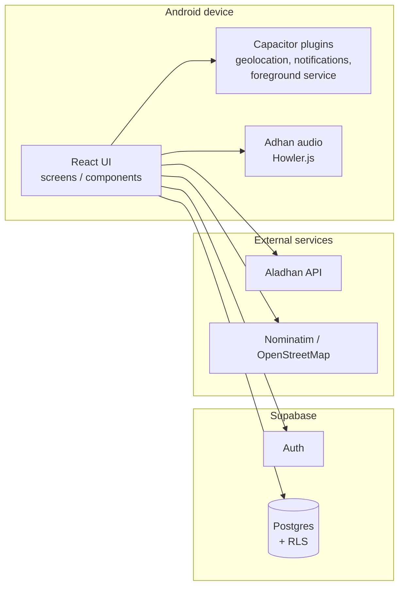

# Architecture — Islame (Road to Islam)

## Overview

Islame is a React + TypeScript application wrapped with Capacitor for Android. The web layer renders the UI and talks to Supabase for authentication and cloud data; native Capacitor plugins provide geolocation, local notifications, push notifications, and the foreground service used for Adhan alarms.

## Diagram

## Layers

| Layer | Responsibility |
|---|---|
| `src/screens/` | Route-level screens, including the admin area |
| `src/components/` | Shared UI, layout, navigation, overlays |
| `src/hooks/` | Prayer times, Qibla, location, progress, mentor chat |
| `src/services/` | Prayer API, lectures, subjects, push notifications |
| `src/lib/` | Supabase client, Adhan player/service, sync, database types |
| `src/i18n/` | Arabic, English, French, Turkish, and Urdu translations |
| `android/` | Capacitor Android shell and native configuration |
| `docs/` | SQL schema, RLS policies, and setup notes |

## Data flow

1. The app requests the user's location through Capacitor Geolocation.
2. Prayer times are fetched from the Aladhan API and cached by the PWA service worker.
3. The native notification/foreground-service layer schedules Adhan alarms.
4. Authentication and mentor/learning data are stored in Supabase and protected by RLS.
5. Static assets and selected API responses are cached for offline use.

## Security boundaries

- Only the Supabase **anon** key is shipped to the client; it relies on RLS for authorization.
- No `service_role` key is used in client code or `VITE_*` variables.
- `android/app/google-services.json`, signing keys, and local SDK paths are excluded from the repository.
- Admin bootstrap scripts are intentionally not included.
- Generated web assets under `android/app/src/main/assets/public/` are build output and are excluded.

## Known limitations

- The repository is a portfolio showcase, not a hosted demo.
- Building the Android project requires a local `google-services.json` for Firebase Cloud Messaging.
- Push notifications and native alarms require testing on a physical Android device.
